# ☕ Bodega de café pergamino — IA en el borde (Edge AI) con ESP32

Proyecto final del curso **Inteligencia Artificial aplicada a Internet de las Cosas**
(Especialización en IA — Actividad 4: implementar un modelo de IA en un microcontrolador).

Tres modelos de IA corren **en los microcontroladores** (Edge AI): un pronóstico de temperatura y
humedad (TinyML), un clasificador del estado del ventilador por vibración y un clasificador de la
calidad del grano con cámara (Edge Impulse). Los datos y las predicciones viajan por **MQTT/TLS a AWS
IoT Core**, se guardan en **DynamoDB**, se ven en un **dashboard** en S3, las alarmas llegan por
**Telegram** y la bodega se puede consultar en lenguaje natural con un **servidor MCP** en el ESP32.

| Requisito de la actividad | Dónde está |
|---|---|
| Caso de uso (T/H, movimiento e imágenes) | [Caso de uso](#caso-de-uso) |
| Modelos de IA en el dispositivo Edge | [Modelo 1](#modelo-1--pronóstico-de-temperatura-y-humedad-tinyml) · [Modelo 2](#modelo-2--estado-del-ventilador-edge-impulse) · [Modelo 3](#modelo-3--calidad-del-grano-con-la-esp32-cam-edge-impulse) |
| ESP32 en WiFi, envío por MQTT | [Arquitectura](#arquitectura) · [Sketch final](#sketch-final-del-esp32) |
| Servidor MCP en lenguaje natural | [Sketch final](#sketch-final-del-esp32) · [Pruebas](#pruebas-de-punta-a-punta) |
| Base de datos | DynamoDB `bodega-lecturas` · [Pruebas](#pruebas-de-punta-a-punta) |
| Dashboard (sensores + predicciones) y alarmas | [Pruebas](#pruebas-de-punta-a-punta) |
| Inconvenientes, resultados y conclusiones | [Inconvenientes](#inconvenientes-y-soluciones) · [Resultados](#resumen-de-resultados) · [Conclusiones](#conclusiones) |

## Caso de uso

Una cooperativa cafetera guarda **café pergamino seco** en una bodega antes de venderlo.
El sistema vigila tres cosas, cada una con un modelo de IA que corre en el dispositivo:

| Qué se vigila | Sensor | Modelo | Herramienta |
|---|---|---|---|
| Temperatura y humedad | DHT11 | Pronóstico de T y H a 5 min → **alerta anticipada** si la bodega va a salir del rango seguro (15–25 °C, 50–65 %) | TinyML (TensorFlow Lite + EloquentTinyML) |
| Ventiladores de la bodega | MPU6050 (acelerómetro) | Clasificación del estado del ventilador por su vibración: `apagado`, `normal`, `desbalanceado`, `obstruido` | Edge Impulse |
| Calidad del grano | ESP32-CAM | Clasificación de la foto del grano: `sano`, `negro` (grano negro), `partido` (grano partido / mordido) | Edge Impulse |

## Arquitectura

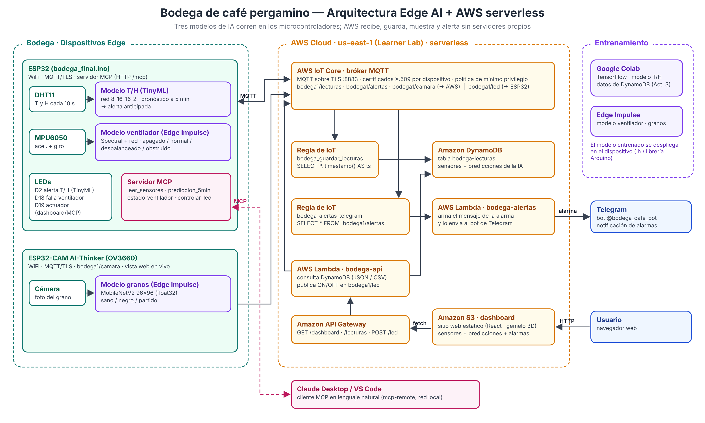

Los **tres modelos de IA corren en los microcontroladores** (Edge AI). La nube solo recibe, guarda,
muestra y alerta, con servicios **serverless de AWS** (reutilizando la Actividad 3):

| Pieza | Servicio | Qué hace |
|---|---|---|
| Bróker | **AWS IoT Core** | MQTT sobre TLS (8883) con certificado X.509 por dispositivo y política de mínimo privilegio |
| Base de datos | **Amazon DynamoDB** (`bodega-lecturas`) | La regla `bodega_guardar_lecturas` guarda cada mensaje de `bodega1/lecturas` (sensores + predicciones) |
| Alarmas | **Regla de IoT + AWS Lambda** (`bodega-alertas`) → **Telegram** | El ESP32 publica en `bodega1/alertas` solo cuando la IA genera una alarma; la Lambda la envía al bot |
| Dashboard | **Amazon S3** + **API Gateway** + **Lambda** (`bodega-api`) | Sitio web estático que consulta DynamoDB y controla el actuador (`bodega1/led`) |
| Lenguaje natural | **Servidor MCP en el ESP32** | Claude / Gemini / VS Code consultan la bodega por `http://<IP>/mcp` (red local) |

| Tema MQTT | Sentido | Contenido |
|---|---|---|
| `bodega1/lecturas` | ESP32 → AWS, cada 10 s | `temperatura`, `humedad`, `estado`, `t_pred`, `h_pred`, `estado_futuro`, `alerta_anticipada`, `vent_clase`, `vent_confianza`, `vent_falla`, `rms_acc`, `rms_giro`, `led` |
| `bodega1/alertas` | ESP32 → AWS, solo al aparecer | `{"tipo": "alerta_anticipada" / "alerta_th" / "falla_ventilador", "mensaje": "..."}` |
| `bodega1/led` | AWS → ESP32 | `ON` / `OFF` (actuador de ventilación, LED D19) |
| `bodega1/camara` | ESP32-CAM → AWS | `{"clase": "sano" / "negro" / "partido", "confianza", "probs"}` (en desarrollo; ver [`docs/contrato-aws.md`](docs/contrato-aws.md)) |

Archivos de AWS en [`aws/`](aws/): política de los dispositivos, SQL de las reglas, la Lambda de alarmas y la
Lambda `bodega-api` del dashboard. Pasos para dejar el dashboard en S3: [`aws/README.md`](aws/README.md).
Formato de los mensajes y de la API: [`docs/contrato-aws.md`](docs/contrato-aws.md).

> También existe una **alternativa local con Docker** (Mosquitto, InfluxDB, Grafana, API de alarmas y
> dashboard 3D) en [`backend/`](backend/) y [`dashboard/`](dashboard/); ver la sección
> [Alternativa local con Docker](#alternativa-local-con-docker). Usa su propio contrato de temas
> ([`docs/contrato-mqtt.md`](docs/contrato-mqtt.md)).

## Alarmas por Telegram en AWS

1. Crear el bot con **@BotFather** y obtener el `chat_id` con `https://api.telegram.org/bot<TOKEN>/getUpdates`.
2. *Lambda → Crear función* `bodega-alertas`, Python 3.12, rol **LabRole**, con
   [`lambda_function.py`](aws/lambda/bodega_alertas/lambda_function.py) y las variables de entorno
   `TELEGRAM_TOKEN` y `TELEGRAM_CHAT_ID` (el token nunca va en el código).
3. *IoT Core → Reglas → Crear regla* `bodega_alertas_telegram`: `SELECT * FROM 'bodega1/alertas'`,
   acción **Lambda** → `bodega-alertas`.
4. Probar en el *Cliente de prueba MQTT* publicando en `bodega1/alertas`:
   `{"tipo":"falla_ventilador","mensaje":"Prueba"}`.

## Modelo 1 — Pronóstico de temperatura y humedad (TinyML)

Entrenado en Google Colab con TensorFlow ([`tinyml/TinyML_bodega_cafe.ipynb`](tinyml/TinyML_bodega_cafe.ipynb))
a partir de las lecturas reales del DHT11 guardadas en DynamoDB en la Actividad 3
([`tinyml/lecturas_bodega.csv`](tinyml/lecturas_bodega.csv), ~2.900 lecturas, 4 sesiones).

- **Entradas (8):** cuánto cambiaron T y H respecto al valor actual hace 1, 2, 3 y 4 minutos.
- **Salidas (2):** cuánto cambiarán T y H en 5 minutos → `T_pred = T_actual + ΔT`.
- Se descartaron otros enfoques: T en función de H (r = 0,29), T/H en función de la hora (solo 11 horas
  con datos) y clasificar `estado` (es una regla fija).
- División cronológica 60/20/20 dentro de cada sesión (no aleatoria, para no filtrar datos casi iguales).
- Modelo exportado: red densa 8 → 16 → 16 → 2, TensorFlow Lite de **3,8 KB**.

| Prueba (último 20 % de cada sesión) | MAE T (°C) | MAE H (%) |
|---|---|---|
| Persistencia ("todo sigue igual") | 0,151 | 1,227 |
| Regresión lineal | 0,139 | 0,882 |
| **Red 16-16 (exportada)** | **0,137** | **0,875** |

- La humedad mejora ~29 % frente a la persistencia.
- Estado a +5 min: **98,0 %** de acierto (persistencia 94,5 %); anticipa el **63 %** de los cambios de
  estado, que la persistencia nunca anticipa.
- En el ESP32 se ejecuta en **microsegundos** con los pesos extraídos a `modelo_th_pesos.h` (ver sketch final).

## Modelo 2 — Estado del ventilador (Edge Impulse)

### Captura de datos

- El MPU6050 se pegó a la carcasa del motor de un ventilador doméstico (siempre a la misma potencia).
- Sketch [`esp32/captura_ventilador`](esp32/captura_ventilador/captura_ventilador.ino): lee el
  acelerómetro a **100 Hz** e imprime `ax,ay,az`. El programa `edge-impulse-data-forwarder`
  envía esas lecturas al proyecto de Edge Impulse.
- **4 clases × 12 muestras de 10 s = 8 min** de datos. División: 40 muestras de entrenamiento y 8 de prueba.

| Clase | Cómo se simuló |
|---|---|
| `apagado` | Ventilador quieto |
| `normal` | Ventilador encendido sin alteraciones |
| `desbalanceado` | Moneda pegada con cinta en una de las aspas |
| `obstruido` | Cartón tapando parte de la rejilla |

### Impulso

| Bloque | Configuración |
|---|---|
| Datos | Ventana de 2000 ms, desplazamiento de 500 ms, 100 Hz, ejes ax/ay/az |
| Procesamiento | Spectral Analysis (39 características) |
| Aprendizaje | Clasificador: red densa 20 → 10 → 4 clases, 50 ciclos, tasa de aprendizaje 0,0005 |
| Dispositivo objetivo | Espressif ESP-EYE (ESP32 240 MHz) |

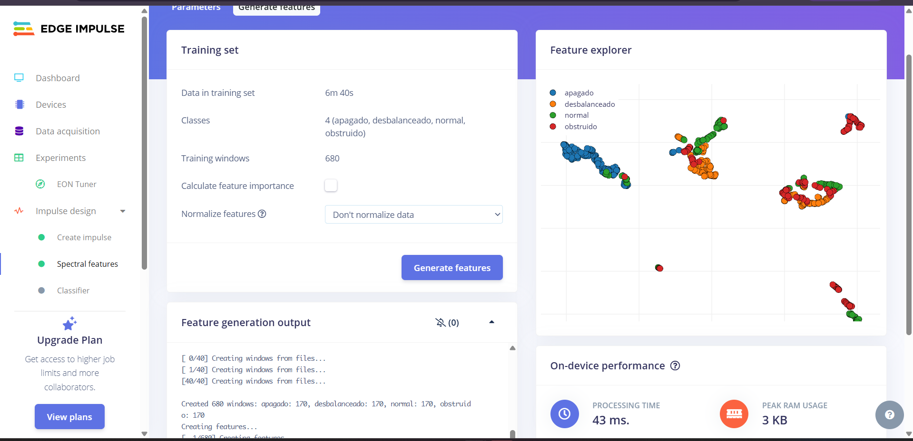

### Resultados

| Conjunto | Accuracy | Observaciones |
|---|---|---|
| Validación | **85,3 %** (AUC 0,98, F1 0,85) | `apagado` 100 %, `desbalanceado` 88 %, `normal` 83 %, `obstruido` 75 % |
| Prueba (muestras nunca vistas) | **79,4 %** (AUC 0,98, F1 0,87) | `apagado` 100 %, `obstruido` 94 %, `desbalanceado` 65 %, `normal` 59 % |

En prueba, la mayor parte del error es **incertidumbre** (ventanas donde ninguna clase supera el 60 %
de confianza), no confusión entre clases: con una moneda la vibración cambia poco frente al
ventilador normal.

En el ESP32: **1 ms** de inferencia, **1,4 KB** de RAM y **15 KB** de flash.


### Prueba en el ESP32

Sketch [`esp32/prueba_ventilador`](esp32/prueba_ventilador/prueba_ventilador.ino): llena una ventana
de 2 s, ejecuta el modelo con `run_classifier` e imprime la clase. Si detecta `desbalanceado` u
`obstruido` con confianza ≥ 0,60 enciende el **LED de D18** (falla del ventilador).

Resultado en el ESP32 (Monitor serie) probando las cuatro clases con el ventilador: el modelo
reconoce `apagado` con confianza 1,00 y detecta `desbalanceado` y `obstruido` (hasta 0,99) marcando
`<<< FALLA EN VENTILADOR`. Cada predicción tarda **4 ms** de procesamiento (Spectral Analysis) y
menos de 1 ms de red neuronal. En `normal` la confianza baja a ~0,55 porque se parece a
`obstruido`, igual que en la matriz de confusión.


## Modelo 3 — Calidad del grano con la ESP32-CAM (Edge Impulse)

### Captura de imágenes

- Cámara **ESP32-CAM AI-Thinker** (sensor OV3660) sobre la base **ESP32-CAM-MB** (USB).
- Sketch [`esp32cam/captura_granos`](esp32cam/captura_granos/captura_granos.ino), basado en el ejemplo
  *CameraWebServer*: se encuadra con el video en el navegador y se toma cada foto con *Get Still* /
  `http://IP/capture`.
- Granos de café sobre fondo blanco, con la cámara fija mirando hacia abajo. Los defectos se simularon
  quemando granos (**grano negro**) y aplastándolos (**grano partido / mordido**).
- **3 clases × 40 fotos = 120 imágenes** ([`esp32cam/fotos`](esp32cam/fotos)), división automática:
  96 de entrenamiento y 24 de prueba. Cada archivo se llama `<clase>.<n>.jpg` para que Edge Impulse
  tome la etiqueta del nombre.

### Impulso

| Bloque | Configuración |
|---|---|
| Datos | Imagen 96 × 96, *Fit shortest axis* |
| Procesamiento | Image (RGB) |
| Aprendizaje | Transfer Learning — MobileNetV2 96x96 0.35, con *data augmentation* |
| Dispositivo objetivo | Espressif ESP-EYE (ESP32 240 MHz) |

### Resultados

| Versión del modelo | Validación | Prueba (24 fotos nunca vistas) |
|---|---|---|
| Cuantizada **int8** | 55 % (clasifica casi todo como `sano`) | — |
| **float32** (la que se despliega) | **95 %** | **95,8 %** (AUC 1,00, F1 0,96): `negro` 100 %, `sano` 100 %, `partido` 87,5 % |

En la ESP32-CAM (float32): **4,5 s** por inferencia, **421 KB** de RAM (necesita la PSRAM) y
**1,6 MB** de flash (partición *Huge APP*). Una clasificación cada ~5 s es suficiente para
inspeccionar lotes de grano.

### En la ESP32-CAM con AWS

Sketch [`esp32cam/camara_bodega`](esp32cam/camara_bodega/camara_bodega.ino) (librería del modelo en
float32 + PubSubClient + ArduinoJson; placa AI Thinker ESP32-CAM, *Huge APP*):

- Cada 10 s toma una foto, la recorta al cuadrado central de 96×96 y la clasifica (**~9 s** de
  inferencia en la ESP32-CAM).
- Publica en `bodega1/camara` (`clase`, `confianza`, `prob_negro`, `prob_partido`, `prob_sano`); la regla
  `bodega_guardar_camara` lo guarda en DynamoDB con `dispositivo = bodega1-camara`.
- Si ve un grano `negro` o `partido` con confianza ≥ 0,80, publica la alarma `grano_defectuoso` en
  `bodega1/alertas` (máximo una vez por minuto).
- Vista web en `http://<IP>` con la cámara en vivo y la última clasificación, para enfocar.
- Tiene su propio *thing* `bodega1-camara`, certificado y política (`secrets.example.h` → `secrets.h`):
  si usara el del ESP32, AWS desconectaría a uno de los dos por tener el mismo nombre de cliente.

[`esp32cam/granos_local`](esp32cam/granos_local/granos_local.ino) es la versión sin AWS (solo clasifica,
con la misma vista web).

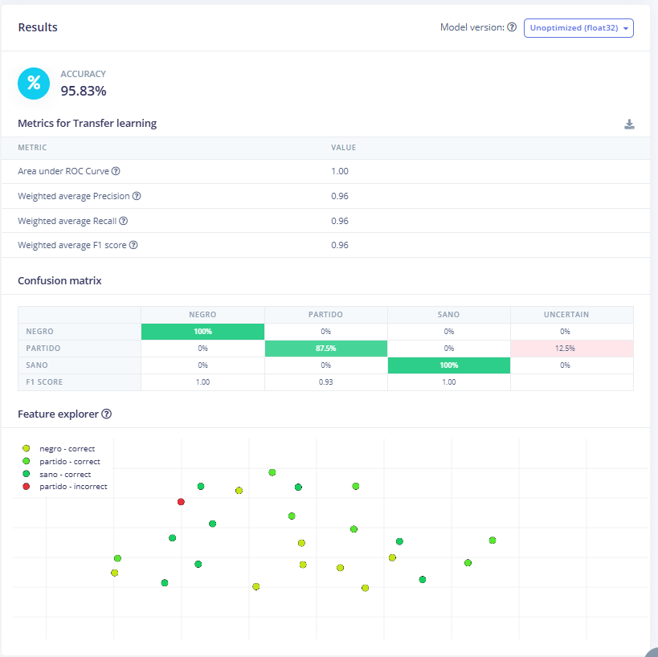
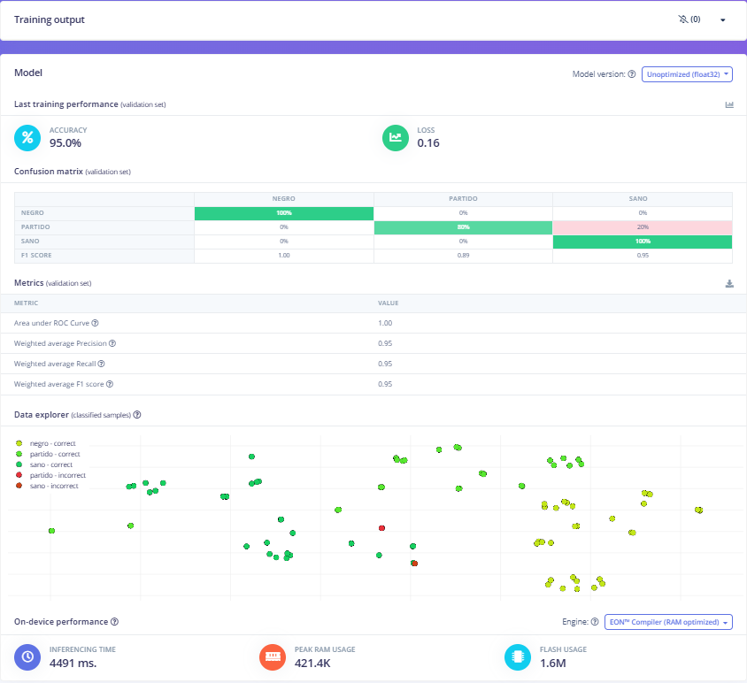
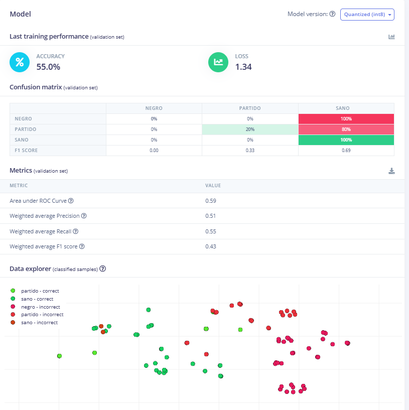

## Sketch final del ESP32

[`esp32/bodega_final`](esp32/bodega_final/bodega_final.ino) corre los dos modelos y se conecta a AWS:

- **Modelo T/H (TinyML):** la red 8-16-16-2 del notebook se ejecuta con sus pesos extraídos a
  `modelo_th_pesos.h`. No se usa EloquentTinyML porque su TensorFlow Lite Micro choca
  ("multiple definition") con el que trae la librería de Edge Impulse.
- **Modelo del ventilador (Edge Impulse):** en una tarea de FreeRTOS a 100 Hz exactos, para que la
  conexión no atrase el muestreo.
- **AWS IoT Core:** WiFi + MQTT/TLS con los certificados de `secrets.h` (copiar `secrets.example.h`).
- **Servidor MCP** (JSON-RPC 2.0 sobre HTTP, `POST /mcp`) con las herramientas `leer_sensores`,
  `prediccion_5min`, `estado_ventilador` y `controlar_led`.

Librerías: `bodega-cafe_inferencing` (Edge Impulse), Adafruit MPU6050, DHT sensor library, PubSubClient
y ArduinoJson 7. Paquete de placas **esp32 2.0.17**. La versión sin conexión (solo Monitor serie) está
en [`esp32/bodega_local`](esp32/bodega_local/bodega_local.ino).

## Conexiones

| Componente | Pin del ESP32 |
|---|---|
| DHT11 (datos) | D4 |
| MPU6050 SDA / SCL | D21 / D22 |
| LED alerta T/H | D2 |
| LED actuador (dashboard / MCP) | D19 |
| LED falla ventilador | D18 |
| VCC / GND de sensores | 3V3 / GND (por los rieles de la protoboard) |

## Montaje físico

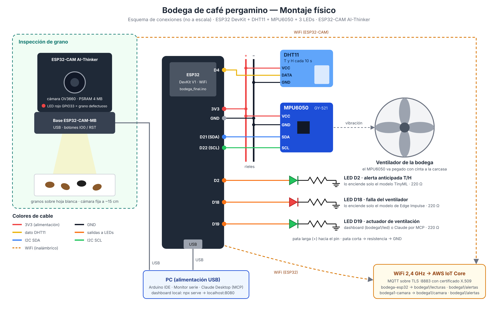

## Pruebas de punta a punta

**Dashboard en S3 (gemelo 3D):** temperatura, humedad y pronóstico TinyML, estado del ventilador, cámara,
alarmas activas y el actuador LED D19.

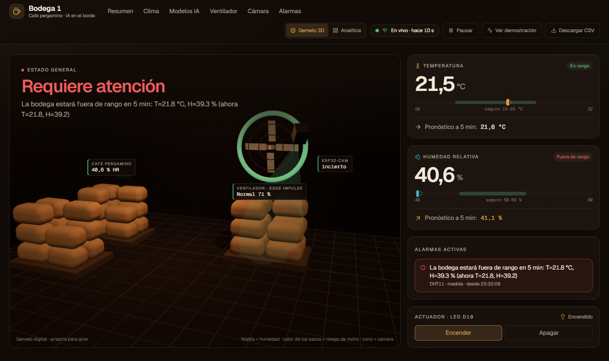
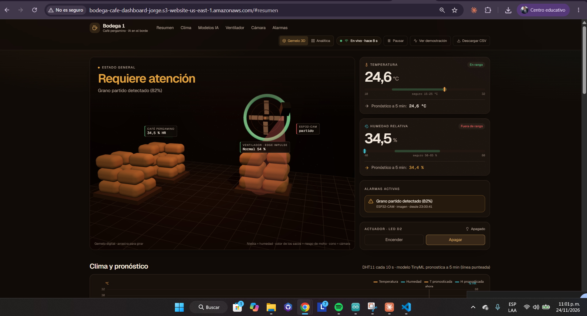

**Cámara en vivo en el dashboard** (abierto en la red local con `npx serve` en `dashboard/dist`) y la
vista web de la propia ESP32-CAM, con la clasificación del modelo:

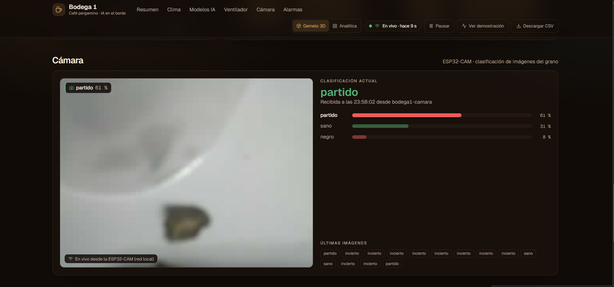
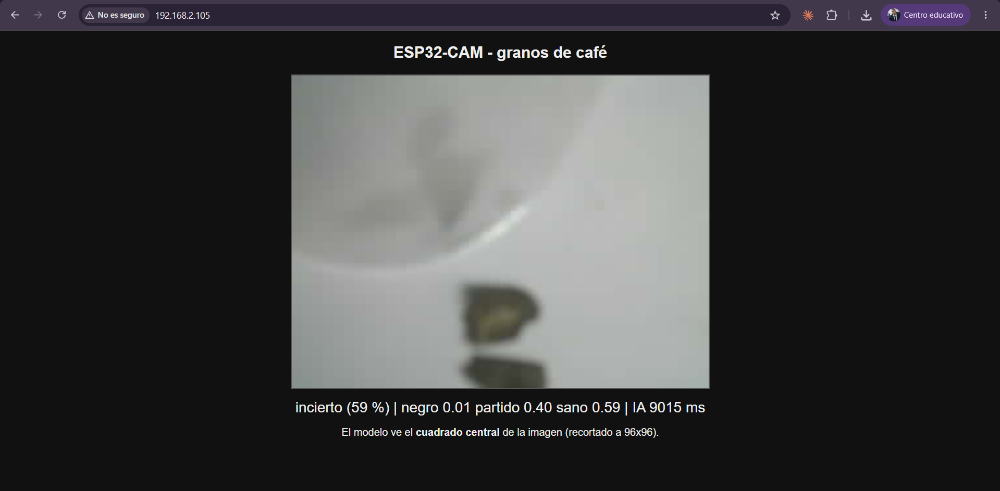

**Alarmas por Telegram** generadas por los tres modelos (☕ grano defectuoso, 🌀 falla del ventilador,
🌡️ alerta de temperatura/humedad):

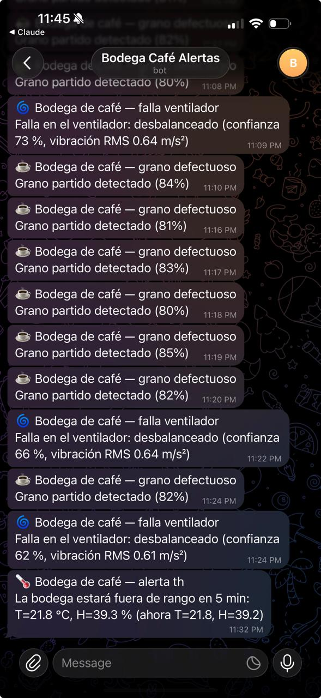

**Servidor MCP desde Claude Desktop:** la pregunta en lenguaje natural usa `leer_sensores`,
`prediccion_5min` y `estado_ventilador`, y "enciende el LED D19" usa `controlar_led`.

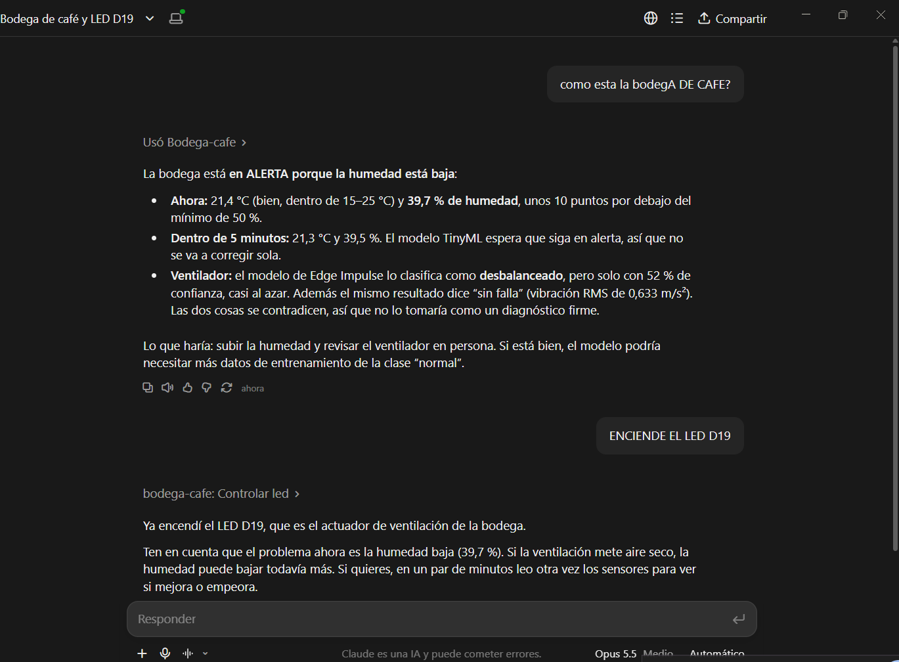

**DynamoDB (`bodega-lecturas`):** una partición por origen de datos (*Explorar elementos → Consultar*).

| `dispositivo` | Contenido |
|---|---|
| `bodega-esp32` | Sensores + pronóstico TinyML + ventilador |
| `bodega1-camara` | Clasificación de granos |
| `alertas` | Historial de alarmas (regla `bodega_guardar_alertas`) |

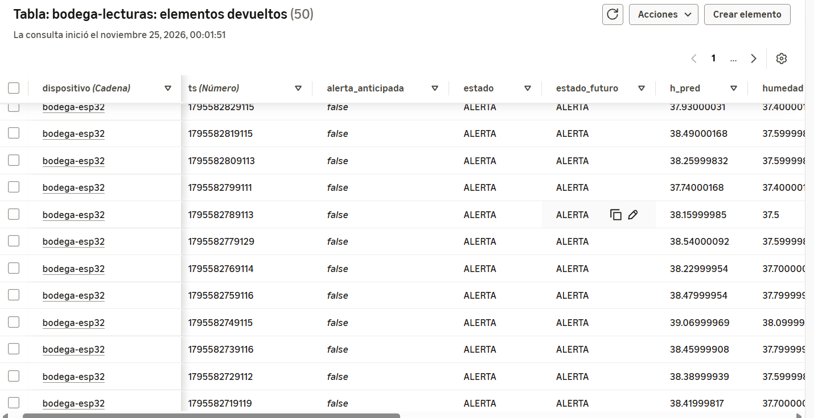
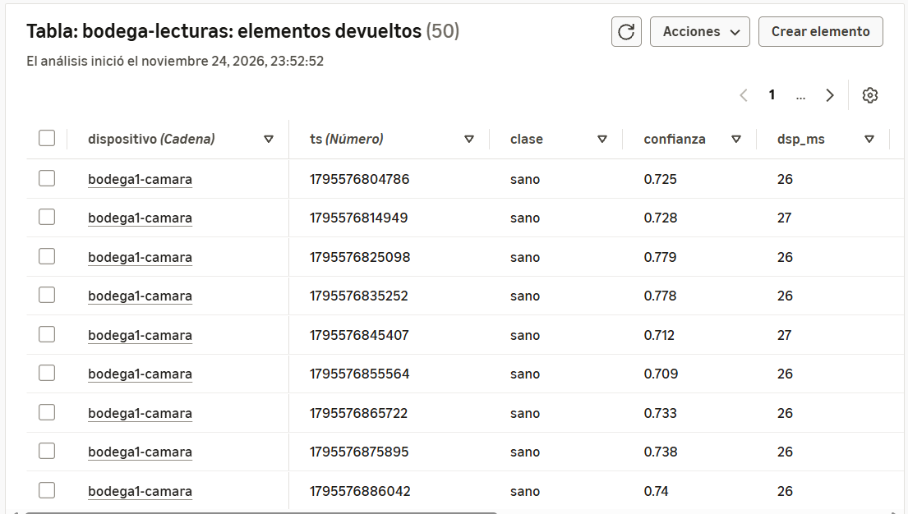
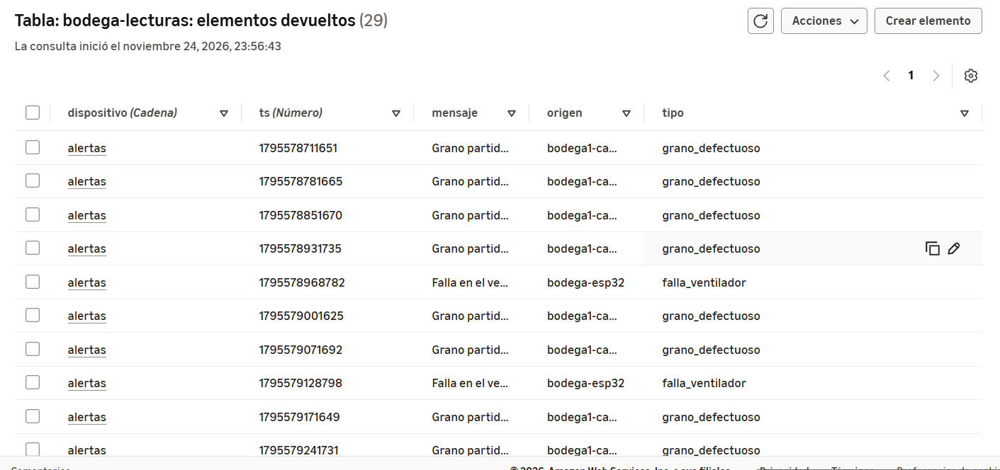

## Cómo poner en marcha la demo

1. **Learner Lab:** *Start Lab* (verde). IoT Core, DynamoDB, Lambda, API Gateway y S3 conservan su configuración.
2. **ESP32** (`esp32/bodega_final`, COM): en el Monitor serie debe salir `Conectando a AWS IoT Core... OK`
   y la IP del servidor MCP. El pronóstico aparece a los ~4 min.
3. **ESP32-CAM** (`esp32cam/camara_bodega`): `AWS IoT... conectado` y `PUB OK` cada 10 s.
4. **Dashboard:** `http://bodega-cafe-dashboard-jorge.s3-website-us-east-1.amazonaws.com/` (o, para ver la
   cámara en vivo, `npx serve -l 8080` dentro de `dashboard/dist` y abrir `http://localhost:8080`).
5. **Claude Desktop** con `mcp-remote` apuntando a `http://<IP del ESP32>/mcp`.
6. Probar: tapar el ventilador o ponerle la moneda (LED D18 + Telegram), poner un grano partido bajo la
   cámara (Telegram), preguntar a Claude por la bodega y encender el actuador.

## Alternativa local con Docker

Backend y dashboard alternativos para correr todo en un PC sin AWS.

### Backend

Todo corre con Docker Compose desde [`backend/`](backend/):

| Servicio | Puerto | Qué hace |
|---|---|---|
| Mosquitto | 1883 | Broker MQTT con usuario y clave (ESP32, ESP32-CAM, Telegraf y API) |
| Telegraf | — | Copia cada tema MQTT a InfluxDB (una tabla por tema: `lecturas`, `pronostico`, `imu`, `ventilador`, `vision`, `alertas`) |
| InfluxDB 2 | 8086 | Base de datos de series de tiempo (bucket `bodega`, retención 30 días) |
| API (FastAPI) | 8000 | Valida los mensajes, los reenvía al dashboard por WebSocket, sirve el historial, recibe fotos de la cámara y genera las **alarmas** |
| Dashboard | 8080 | El dashboard compilado, servido por nginx |
| Grafana | 3000 | Tablero `bodega-ia` aprovisionado automáticamente (datasource + paneles) |

```bash
cd backend
cp .env.example .env          # cambiar TODAS las claves y poner el bot de Telegram
docker compose up -d --build
```

Sin hardware se puede probar todo con el simulador, que publica los mismos temas que el ESP32 y la
ESP32-CAM siguiendo un guion de 3 minutos que pasa por todas las alarmas:

```bash
pip install paho-mqtt
python backend/simulador/simular_bodega.py --velocidad 2
```

#### Alarmas a partir de los modelos de IA

El motor de alarmas ([`backend/api/app/alarmas.py`](backend/api/app/alarmas.py)) usa histéresis para no
llenar Telegram de avisos repetidos. Cada alarma activada o resuelta se envía por **Telegram**, se publica
en `bodega1/alertas` (Telegraf la guarda en InfluxDB) y aparece en el dashboard.

| Regla | Se activa | Nivel |
|---|---|---|
| Pronóstico TinyML | el modelo pronostica T o H fuera de rango a 5 min (**alerta anticipada**) | aviso / crítica si se aleja ≥ 4 unidades |
| Ambiente | la lectura actual del DHT11 sale del rango 15–25 °C, 50–65 % | crítica |
| Ventilador | `desbalanceado` u `obstruido` con confianza ≥ 0,60 en 3 ventanas seguidas (6 s) | crítica |
| Cámara | clase de `VISION_CLASES_ALERTA` con confianza ≥ 0,70 (la foto va adjunta en Telegram) | aviso |
| Sin datos | el ESP32 no publica en 60 s | aviso |

Para Telegram: crear el bot con **@BotFather**, escribirle un mensaje y poner `TELEGRAM_TOKEN` y
`TELEGRAM_CHAT_ID` en `backend/.env`. Las reglas tienen pruebas: `cd backend/api && python -m pytest`.

### Dashboard

React + Vite + TypeScript, Tailwind CSS 4, ECharts (canvas, para datos en tiempo real),
react-three-fiber (gemelo digital 3D), Motion y Lucide. Tipografía Geist / Geist Mono.

Tiene **dos vistas** (selector arriba a la derecha, se recuerda en el navegador):

- **Gemelo 3D**: la bodega en 3D se mueve con los datos. El ventilador gira, tiembla o se frena según
  la clase de Edge Impulse; la niebla se vuelve más densa con la humedad; los sacos se oscurecen con riesgo
  de moho; el cono de la ESP32-CAM cambia de color con la clasificación.
- **Analítica**: sin 3D, con el estado de cada modelo y su confianza en anillos, y la gráfica de clima.

Las dos comparten las secciones de **Modelos de IA** (confianza en el tiempo con umbrales, probabilidades
apiladas del ventilador, error del pronóstico TinyML frente a la lectura real y distribución de clases),
ventilador (acelerómetro, giroscopio y línea de tiempo de ventanas), cámara y alarmas.


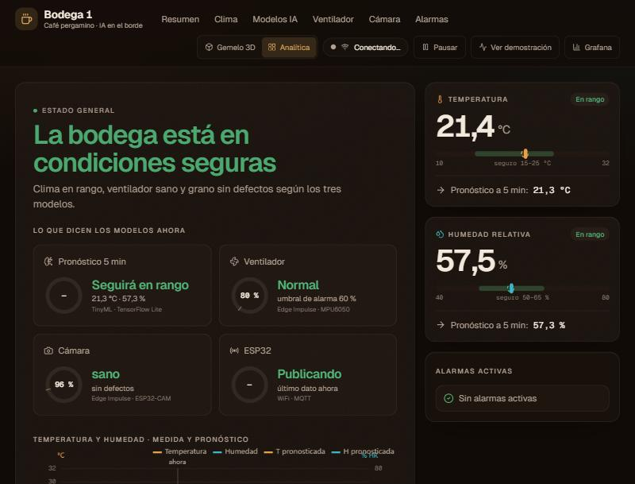
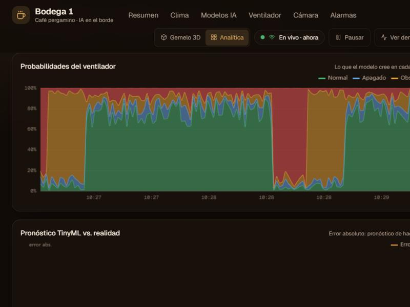
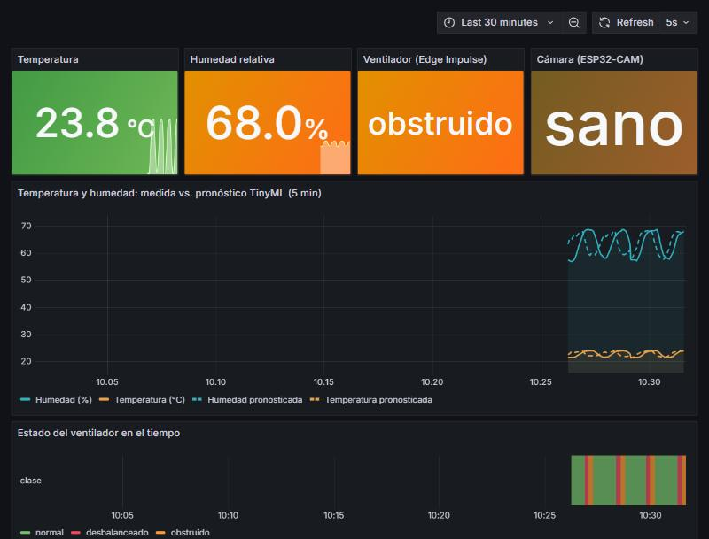

Desarrollo local (con la API corriendo en el puerto 8000):

```bash
cd dashboard
npm install
npm run dev        # http://localhost:5173
```

Parámetros de la URL: `?demo` (demostración sin backend), `?vel=3` (acelera la demo),
`?vista=3d|analitica`, `?api=http://IP:8000` y `?grafana=URL`. Si la API no responde, el dashboard pasa
solo a la demostración y lo indica en el encabezado («Demostración»).

## Estructura del repositorio

```
esp32/
  captura_ventilador/   Captura del acelerómetro para Edge Impulse
  prueba_ventilador/    Prueba del modelo del ventilador en el ESP32
  bodega_final/         Sketch final: 2 modelos + AWS IoT Core + servidor MCP (secrets.example.h)
  bodega_local/         Versión sin conexión del sketch integrado (solo Monitor serie)
esp32cam/
  captura_granos/       Captura de fotos con la ESP32-CAM (CameraWebServer)
  camara_bodega/        Clasificación de granos + AWS IoT Core + vista web (secrets.example.h)
  granos_local/         Clasificación de granos sin AWS (solo vista web)
  fotos/                Dataset: 40 fotos por clase (sano, negro, partido)
aws/
  iot/                  Política del dispositivo y SQL de las reglas de IoT
  lambda/bodega_alertas Lambda que envía las alarmas a Telegram
  lambda/bodega_api     Lambda de la API del dashboard (GET /dashboard, /lecturas, /lecturas/csv, POST /led)
  README.md             Pasos de despliegue en AWS y del dashboard en S3
edge-impulse/           Notas del proyecto de Edge Impulse
tinyml/                 Modelo T/H: notebook de Colab, CSV de entrenamiento, .tflite y sketch de prueba
backend/
  docker-compose.yml    Mosquitto, Telegraf, InfluxDB, API, dashboard y Grafana
  api/                  API FastAPI: tiempo real, historial, cámara y alarmas (con pruebas)
  telegraf/ mosquitto/  Configuración del broker y de la ingesta
  grafana/              Datasource y tablero aprovisionados
  simulador/            Simulador del ESP32 y la ESP32-CAM
dashboard/              Dashboard React (vista 3D y vista analítica)
docs/                   Contrato MQTT, diagramas y capturas
```

## Inconvenientes y soluciones

| Inconveniente | Solución |
|---|---|
| `npm install -g edge-impulse-cli` falló: no encontraba Visual Studio para compilar `@serialport/bindings` | Instalar *Build Tools for Visual Studio* con "Desarrollo para el escritorio con C++" |
| npm 11 no ejecutó los scripts de instalación (`allow-scripts`) y el forwarder no podía leer el puerto | `npm install -g edge-impulse-cli --force --allow-scripts=serialport,sharp,@serialport/bindings` |
| El forwarder no conectaba | Cerrar el Monitor serie del Arduino IDE (el puerto COM solo lo usa un programa a la vez) |
| El MPU6050 (GY-521) venía con los pines sin soldar | Prueba provisional: pines en la protoboard y el módulo inclinado y sujeto con cinta |
| `tflm_esp32` 1.0.0 no compilaba con el paquete de placas ESP32 3.x | Usar el paquete de placas **esp32 de Espressif 2.0.17** |
| Las primeras fotos de la ESP32-CAM salían borrosas y con el fondo texturizado (toalla de papel) | Subir la cámara a mayor distancia y usar una hoja blanca lisa como fondo |
| Edge Impulse no dejaba elegir la etiqueta al subir las fotos: quedaron sin etiqueta o con el nombre del archivo | Renombrar los archivos como `<clase>.<n>.jpg` (Edge Impulse toma la etiqueta de lo que va antes del primer punto) y corregir con *Edit labels* |
| El proyecto de la cámara se creó como *Object detection* y no aparecía el bloque de clasificación | *Dashboard → Labeling method → One label per data item* |
| El modelo de imágenes cuantizado (int8) bajó a 55 % de accuracy | Desplegar la versión **float32** (95,8 % en prueba); la ESP32-CAM tiene PSRAM suficiente |
| Al juntar los dos modelos en un solo sketch, EloquentTinyML/`tflm_esp32` y la librería de Edge Impulse daban "multiple definition" al enlazar (las dos traen TensorFlow Lite Micro) | La red T/H se ejecuta con sus pesos extraídos a `modelo_th_pesos.h` (mismas salidas que el intérprete de TFLite) |
| En la ESP32-CAM el modelo de granos fallaba con `Failed to allocate persistent buffer ... reached EI_MAX_OVERFLOW_BUFFER_COUNT` | Subir `EI_MAX_OVERFLOW_BUFFER_COUNT` de 10 a 300 en `src/tflite-model/tflite_learn_*_compiled.cpp` de la librería instalada |
| La ESP32-CAM veía colores distintos a los de las fotos de entrenamiento | Usar los mismos ajustes del sensor OV3660 que CameraWebServer (`vflip`, brillo +1, **saturación −2**) |
| La ESP32-CAM se quedaba reintentando AWS (`rc=-2`) en el `setup()` y la vista web no respondía | Reconexión sin bloquear (un intento cada 5 s) e imprimir el motivo TLS con `net.lastError()`; además activar el certificado y asociarle la política y el *thing* |
| Tailwind CSS 4.0.0 fallaba al compilar los estilos (`Cannot convert undefined or null to object`) | Actualizar a Tailwind 4.1.11 |
| El archivo de claves de Mosquitto no se puede subir a GitHub y escrito desde Windows queda con saltos de línea CRLF | Generarlo en el arranque del contenedor con `mosquitto_passwd` a partir del `.env` |
| La API recibe sus propias alarmas al estar suscrita a `bodega1/#` | El contrato ignora `bodega1/alertas` al validar mensajes |

## Resumen de resultados

| Modelo | Dónde corre | Resultado | Tiempo en el dispositivo |
|---|---|---|---|
| Pronóstico T/H (TinyML, red 8-16-16-2) | ESP32 | MAE 0,137 °C y 0,875 % HR; estado a +5 min 98 % | < 1 ms (3,8 KB) |
| Ventilador (Edge Impulse, Spectral + red 20-10) | ESP32 | 85,3 % validación · 79,4 % prueba (AUC 0,98) | 4 ms DSP + < 1 ms red (1,4 KB RAM) |
| Granos (Edge Impulse, MobileNetV2 96×96 float32) | ESP32-CAM | 95 % validación · 95,8 % prueba (AUC 1,00) | ~9 s (421 KB RAM en PSRAM) |

## Conclusiones

- **La IA en el borde funciona en hardware de pocos dólares:** los tres modelos corren en los
  microcontroladores; la nube solo recibe resultados. Así el sistema reacciona (LEDs) aunque se caiga
  internet, y se envían unos pocos bytes de predicción en vez de datos crudos o imágenes.
- **Cada problema pidió un enfoque distinto:** con pocos datos de T/H, un pronóstico de corto plazo
  con diferencias supera a la persistencia y anticipa alertas; la vibración se separa bien con análisis
  espectral; las imágenes necesitaron *transfer learning*.
- **El despliegue importa tanto como el entrenamiento:** la cuantización int8 hundió el modelo de
  imágenes (55 %), los colores de la cámara debían coincidir con los del entrenamiento y las dos
  librerías de TensorFlow Lite no podían convivir en un mismo sketch.
- **La arquitectura serverless de la Actividad 3 se reutilizó casi completa:** solo se agregaron reglas
  de IoT, una Lambda de alarmas y un thing para la cámara.
- **MCP convierte el dispositivo en una herramienta para un asistente de IA:** Claude combina las
  lecturas y las predicciones de los modelos para responder y actuar en lenguaje natural.
- **Limitaciones y mejoras:** pocos datos (8 h de T/H, 48 muestras de vibración, 120 fotos), el
  desbalance simulado con una moneda y fotos algo borrosas. Con más días de datos, un desbalance real y
  la cámara enfocada mejorarían los modelos; el dashboard en S3 no puede mostrar la cámara en vivo por
  la protección de red local del navegador (se resolvería subiendo las fotos a S3).

## Equipo

Juliana Campuzano · Jorge Iván González · Miguel Diuza · Yolima Guadir — Especialización en Inteligencia
Artificial, curso Inteligencia Artificial aplicada a IoT.
