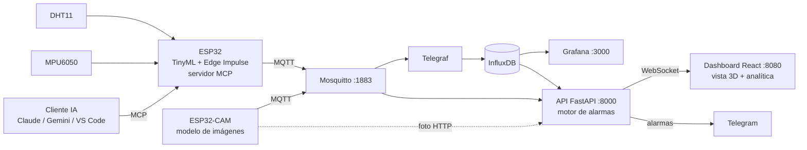
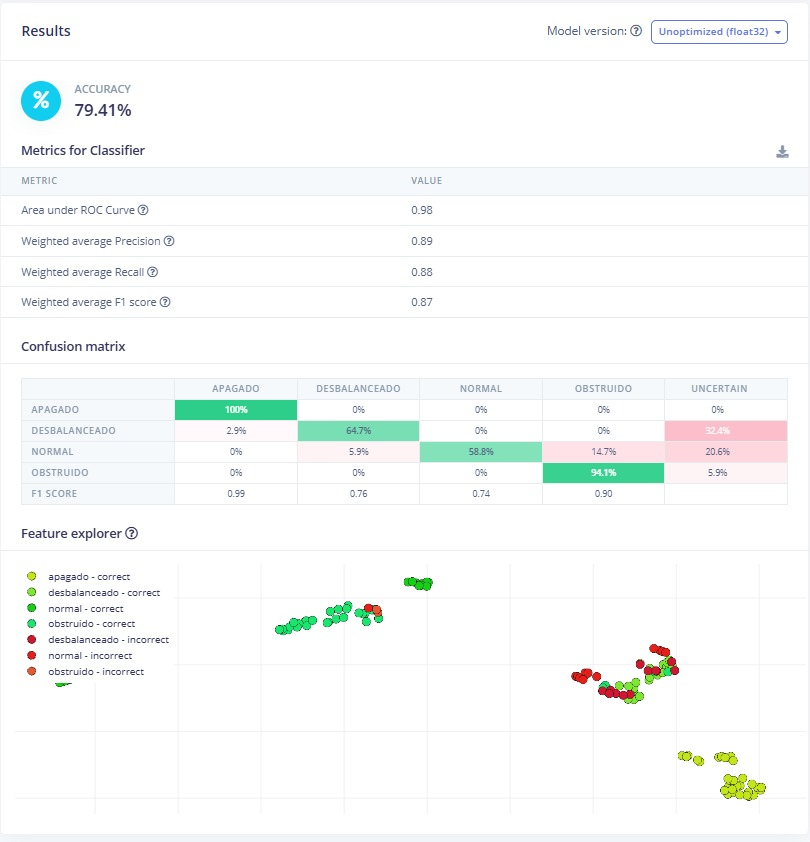
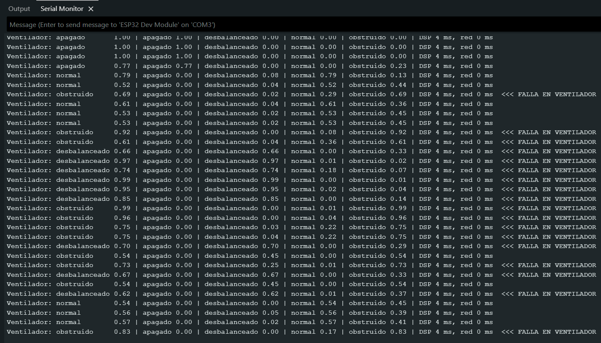
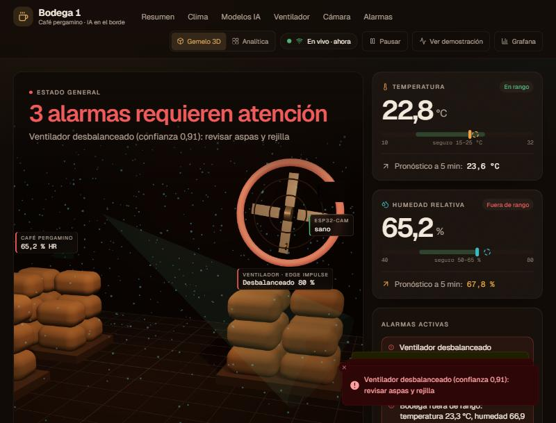

# ☕ Bodega de café pergamino — IA en el borde (Edge AI) con ESP32

Proyecto final del curso **Inteligencia Artificial aplicada a Internet de las Cosas**
(Especialización en IA — Actividad 4: implementar un modelo de IA en un microcontrolador).

> 🚧 En construcción. Este README se va completando a medida que avanza el proyecto.

## Caso de uso

Una cooperativa cafetera guarda **café pergamino seco** en una bodega antes de venderlo.
El sistema vigila tres cosas, cada una con un modelo de IA que corre en el dispositivo:

| Qué se vigila | Sensor | Modelo | Herramienta |
|---|---|---|---|
| Temperatura y humedad | DHT11 | Pronóstico de T y H a 5 min → **alerta anticipada** si la bodega va a salir del rango seguro (15–25 °C, 50–65 %) | TinyML (TensorFlow Lite + EloquentTinyML) |
| Ventiladores de la bodega | MPU6050 (acelerómetro) | Clasificación del estado del ventilador por su vibración: `apagado`, `normal`, `desbalanceado`, `obstruido` | Edge Impulse |
| Imágenes | ESP32-CAM | Por definir | Edge Impulse |

## Arquitectura



El contrato de temas MQTT, campos JSON y endpoints está en [`docs/contrato-mqtt.md`](docs/contrato-mqtt.md).
El firmware final (`esp32/bodega_final`, `esp32cam/`) solo tiene que publicar con esos temas.

## Modelo 2 — Estado del ventilador (Edge Impulse)

### Captura de datos

- El MPU6050 se pegó a la carcasa del motor de un ventilador doméstico (siempre a la misma potencia).
- Sketch [`esp32/captura_ventilador`](esp32/captura_ventilador/captura_ventilador.ino): lee el
  acelerómetro a **100 Hz** e imprime `ax,ay,az`. El programa `edge-impulse-data-forwarder`
  envía esas lecturas al proyecto de Edge Impulse.
- **4 clases × 12 muestras de 10 s = 8 min** de datos. División: 40 muestras de entrenamiento y 8 de prueba.

| Clase | Cómo se simuló |
|---|---|
| `apagado` | Ventilador quieto |
| `normal` | Ventilador encendido sin alteraciones |
| `desbalanceado` | Moneda pegada con cinta en una de las aspas |
| `obstruido` | Cartón tapando parte de la rejilla |

### Impulso

| Bloque | Configuración |
|---|---|
| Datos | Ventana de 2000 ms, desplazamiento de 500 ms, 100 Hz, ejes ax/ay/az |
| Procesamiento | Spectral Analysis (39 características) |
| Aprendizaje | Clasificador: red densa 20 → 10 → 4 clases, 50 ciclos, tasa de aprendizaje 0,0005 |
| Dispositivo objetivo | Espressif ESP-EYE (ESP32 240 MHz) |


### Resultados

| Conjunto | Accuracy | Observaciones |
|---|---|---|
| Validación | **85,3 %** (AUC 0,98, F1 0,85) | `apagado` 100 %, `desbalanceado` 88 %, `normal` 83 %, `obstruido` 75 % |
| Prueba (muestras nunca vistas) | **79,4 %** (AUC 0,98, F1 0,87) | `apagado` 100 %, `obstruido` 94 %, `desbalanceado` 65 %, `normal` 59 % |

En prueba, la mayor parte del error es **incertidumbre** (ventanas donde ninguna clase supera el 60 %
de confianza), no confusión entre clases: con una moneda la vibración cambia poco frente al
ventilador normal.

En el ESP32: **1 ms** de inferencia, **1,4 KB** de RAM y **15 KB** de flash.




### Prueba en el ESP32

Sketch [`esp32/prueba_ventilador`](esp32/prueba_ventilador/prueba_ventilador.ino): llena una ventana
de 2 s, ejecuta el modelo con `run_classifier` e imprime la clase. Si detecta `desbalanceado` u
`obstruido` con confianza ≥ 0,60 enciende el **LED de D18** (falla del ventilador).

Resultado en el ESP32 (Monitor serie) probando las cuatro clases con el ventilador: el modelo
reconoce `apagado` con confianza 1,00 y detecta `desbalanceado` y `obstruido` (hasta 0,99) marcando
`<<< FALLA EN VENTILADOR`. Cada predicción tarda **4 ms** de procesamiento (Spectral Analysis) y
menos de 1 ms de red neuronal. En `normal` la confianza baja a ~0,55 porque se parece a
`obstruido`, igual que en la matriz de confusión.



## Conexiones

| Componente | Pin del ESP32 |
|---|---|
| DHT11 (datos) | D4 |
| MPU6050 SDA / SCL | D21 / D22 |
| LED alerta T/H | D2 |
| LED falla ventilador | D18 |
| VCC / GND de sensores | 3V3 / GND (por los rieles de la protoboard) |

## Backend

Todo corre con Docker Compose desde [`backend/`](backend/):

| Servicio | Puerto | Qué hace |
|---|---|---|
| Mosquitto | 1883 | Broker MQTT con usuario y clave (ESP32, ESP32-CAM, Telegraf y API) |
| Telegraf | — | Copia cada tema MQTT a InfluxDB (una tabla por tema: `lecturas`, `pronostico`, `imu`, `ventilador`, `vision`, `alertas`) |
| InfluxDB 2 | 8086 | Base de datos de series de tiempo (bucket `bodega`, retención 30 días) |
| API (FastAPI) | 8000 | Valida los mensajes, los reenvía al dashboard por WebSocket, sirve el historial, recibe fotos de la cámara y genera las **alarmas** |
| Dashboard | 8080 | El dashboard compilado, servido por nginx |
| Grafana | 3000 | Tablero `bodega-ia` aprovisionado automáticamente (datasource + paneles) |

```bash
cd backend
cp .env.example .env          # cambiar TODAS las claves y poner el bot de Telegram
docker compose up -d --build
```

Sin hardware se puede probar todo con el simulador, que publica los mismos temas que el ESP32 y la
ESP32-CAM siguiendo un guion de 3 minutos que pasa por todas las alarmas:

```bash
pip install paho-mqtt
python backend/simulador/simular_bodega.py --velocidad 2
```

### Alarmas a partir de los modelos de IA

El motor de alarmas ([`backend/api/app/alarmas.py`](backend/api/app/alarmas.py)) usa histéresis para no
llenar Telegram de avisos repetidos. Cada alarma activada o resuelta se envía por **Telegram**, se publica
en `bodega1/alertas` (Telegraf la guarda en InfluxDB) y aparece en el dashboard.

| Regla | Se activa | Nivel |
|---|---|---|
| Pronóstico TinyML | el modelo pronostica T o H fuera de rango a 5 min (**alerta anticipada**) | aviso / crítica si se aleja ≥ 4 unidades |
| Ambiente | la lectura actual del DHT11 sale del rango 15–25 °C, 50–65 % | crítica |
| Ventilador | `desbalanceado` u `obstruido` con confianza ≥ 0,60 en 3 ventanas seguidas (6 s) | crítica |
| Cámara | clase de `VISION_CLASES_ALERTA` con confianza ≥ 0,70 (la foto va adjunta en Telegram) | aviso |
| Sin datos | el ESP32 no publica en 60 s | aviso |

Para Telegram: crear el bot con **@BotFather**, escribirle un mensaje y poner `TELEGRAM_TOKEN` y
`TELEGRAM_CHAT_ID` en `backend/.env`. Las reglas tienen pruebas: `cd backend/api && python -m pytest`.

## Dashboard

React + Vite + TypeScript, Tailwind CSS 4, ECharts (canvas, para datos en tiempo real),
react-three-fiber (gemelo digital 3D), Motion y Lucide. Tipografía Geist / Geist Mono.

Tiene **dos vistas** (selector arriba a la derecha, se recuerda en el navegador):

- **Gemelo 3D**: la bodega en 3D se mueve con los datos. El ventilador gira, tiembla o se frena según
  la clase de Edge Impulse; la niebla se vuelve más densa con la humedad; los sacos se oscurecen con riesgo
  de moho; el cono de la ESP32-CAM cambia de color con la clasificación.
- **Analítica**: sin 3D, con el estado de cada modelo y su confianza en anillos, y la gráfica de clima.

Las dos comparten las secciones de **Modelos de IA** (confianza en el tiempo con umbrales, probabilidades
apiladas del ventilador, error del pronóstico TinyML frente a la lectura real y distribución de clases),
ventilador (acelerómetro, giroscopio y línea de tiempo de ventanas), cámara y alarmas.




Desarrollo local (con la API corriendo en el puerto 8000):

```bash
cd dashboard
npm install
npm run dev        # http://localhost:5173
```

Parámetros de la URL: `?demo` (demostración sin backend), `?vel=3` (acelera la demo),
`?vista=3d|analitica`, `?api=http://IP:8000` y `?grafana=URL`. Si la API no responde, el dashboard pasa
solo a la demostración y lo indica en el encabezado («Demostración»).

## Estructura del repositorio

```
esp32/
  captura_ventilador/   Captura del acelerómetro para Edge Impulse
  prueba_ventilador/    Prueba del modelo del ventilador en el ESP32
  bodega_final/         Sketch final (modelos + WiFi + MQTT + servidor MCP)
esp32cam/               Sketch de la cámara
edge-impulse/           Notas del proyecto de Edge Impulse
tinyml/                 Modelo de temperatura y humedad (notebook + .h)
backend/
  docker-compose.yml    Mosquitto, Telegraf, InfluxDB, API, dashboard y Grafana
  api/                  API FastAPI: tiempo real, historial, cámara y alarmas (con pruebas)
  telegraf/ mosquitto/  Configuración del broker y de la ingesta
  grafana/              Datasource y tablero aprovisionados
  simulador/            Simulador del ESP32 y la ESP32-CAM
dashboard/              Dashboard React (vista 3D y vista analítica)
docs/                   Contrato MQTT, diagramas y capturas
```

## Inconvenientes y soluciones

| Inconveniente | Solución |
|---|---|
| `npm install -g edge-impulse-cli` falló: no encontraba Visual Studio para compilar `@serialport/bindings` | Instalar *Build Tools for Visual Studio* con "Desarrollo para el escritorio con C++" |
| npm 11 no ejecutó los scripts de instalación (`allow-scripts`) y el forwarder no podía leer el puerto | `npm install -g edge-impulse-cli --force --allow-scripts=serialport,sharp,@serialport/bindings` |
| El forwarder no conectaba | Cerrar el Monitor serie del Arduino IDE (el puerto COM solo lo usa un programa a la vez) |
| El MPU6050 (GY-521) venía con los pines sin soldar | Prueba provisional: pines en la protoboard y el módulo inclinado y sujeto con cinta |
| `tflm_esp32` 1.0.0 no compilaba con el paquete de placas ESP32 3.x | Usar el paquete de placas **esp32 de Espressif 2.0.17** |
| Tailwind CSS 4.0.0 fallaba al compilar los estilos (`Cannot convert undefined or null to object`) | Actualizar a Tailwind 4.1.11 |
| El archivo de claves de Mosquitto no se puede subir a GitHub y escrito desde Windows queda con saltos de línea CRLF | Generarlo en el arranque del contenedor con `mosquitto_passwd` a partir del `.env` |
| La API recibe sus propias alarmas al estar suscrita a `bodega1/#` | El contrato ignora `bodega1/alertas` al validar mensajes |

## Equipo

Proyecto en grupo — Especialización en IA.
