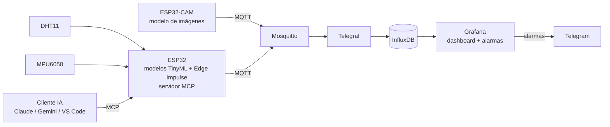
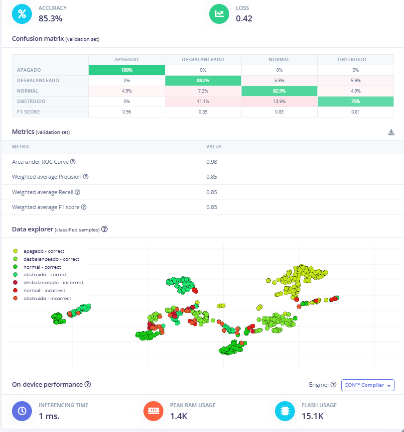

# ☕ Bodega de café pergamino — IA en el borde (Edge AI) con ESP32

Proyecto final del curso **Inteligencia Artificial aplicada a Internet de las Cosas**
(Especialización en IA — Actividad 4: implementar un modelo de IA en un microcontrolador).

> 🚧 En construcción. Este README se va completando a medida que avanza el proyecto.

## Caso de uso

Una cooperativa cafetera guarda **café pergamino seco** en una bodega antes de venderlo.
El sistema vigila tres cosas, cada una con un modelo de IA que corre en el dispositivo:

| Qué se vigila | Sensor | Modelo | Herramienta |
|---|---|---|---|
| Temperatura y humedad | DHT11 | Pronóstico de T y H a 5 min → **alerta anticipada** si la bodega va a salir del rango seguro (15–25 °C, 50–65 %) | TinyML (TensorFlow Lite + EloquentTinyML) |
| Ventiladores de la bodega | MPU6050 (acelerómetro) | Clasificación del estado del ventilador por su vibración: `apagado`, `normal`, `desbalanceado`, `obstruido` | Edge Impulse |
| Imágenes | ESP32-CAM | Por definir | Edge Impulse |

## Arquitectura (planeada)



## Modelo 2 — Estado del ventilador (Edge Impulse)

### Captura de datos

- El MPU6050 se pegó a la carcasa del motor de un ventilador doméstico (siempre a la misma potencia).
- Sketch [`esp32/captura_ventilador`](esp32/captura_ventilador/captura_ventilador.ino): lee el
  acelerómetro a **100 Hz** e imprime `ax,ay,az`. El programa `edge-impulse-data-forwarder`
  envía esas lecturas al proyecto de Edge Impulse.
- **4 clases × 12 muestras de 10 s = 8 min** de datos. División: 40 muestras de entrenamiento y 8 de prueba.

| Clase | Cómo se simuló |
|---|---|
| `apagado` | Ventilador quieto |
| `normal` | Ventilador encendido sin alteraciones |
| `desbalanceado` | Moneda pegada con cinta en una de las aspas |
| `obstruido` | Cartón tapando parte de la rejilla |

### Impulso

| Bloque | Configuración |
|---|---|
| Datos | Ventana de 2000 ms, desplazamiento de 500 ms, 100 Hz, ejes ax/ay/az |
| Procesamiento | Spectral Analysis (39 características) |
| Aprendizaje | Clasificador: red densa 20 → 10 → 4 clases, 50 ciclos, tasa de aprendizaje 0,0005 |
| Dispositivo objetivo | Espressif ESP-EYE (ESP32 240 MHz) |


### Resultados

| Conjunto | Accuracy | Observaciones |
|---|---|---|
| Validación | **85,3 %** (AUC 0,98, F1 0,85) | `apagado` 100 %, `desbalanceado` 88 %, `normal` 83 %, `obstruido` 75 % |
| Prueba (muestras nunca vistas) | **79,4 %** (AUC 0,98, F1 0,87) | `apagado` 100 %, `obstruido` 94 %, `desbalanceado` 65 %, `normal` 59 % |

En prueba, la mayor parte del error es **incertidumbre** (ventanas donde ninguna clase supera el 60 %
de confianza), no confusión entre clases: con una moneda la vibración cambia poco frente al
ventilador normal.

En el ESP32: **1 ms** de inferencia, **1,4 KB** de RAM y **15 KB** de flash.




### Prueba en el ESP32

Sketch [`esp32/prueba_ventilador`](esp32/prueba_ventilador/prueba_ventilador.ino): llena una ventana
de 2 s, ejecuta el modelo con `run_classifier` e imprime la clase. Si detecta `desbalanceado` u
`obstruido` con confianza ≥ 0,60 enciende el **LED de D18** (falla del ventilador).

Resultado en el ESP32 (Monitor serie) probando las cuatro clases con el ventilador: el modelo
reconoce `apagado` con confianza 1,00 y detecta `desbalanceado` y `obstruido` (hasta 0,99) marcando
`<<< FALLA EN VENTILADOR`. Cada predicción tarda **4 ms** de procesamiento (Spectral Analysis) y
menos de 1 ms de red neuronal. En `normal` la confianza baja a ~0,55 porque se parece a
`obstruido`, igual que en la matriz de confusión.


## Conexiones

| Componente | Pin del ESP32 |
|---|---|
| DHT11 (datos) | D4 |
| MPU6050 SDA / SCL | D21 / D22 |
| LED alerta T/H | D2 |
| LED falla ventilador | D18 |
| VCC / GND de sensores | 3V3 / GND (por los rieles de la protoboard) |

## Estructura del repositorio

```
esp32/
  captura_ventilador/   Captura del acelerómetro para Edge Impulse
  prueba_ventilador/    Prueba del modelo del ventilador en el ESP32
  bodega_final/         Sketch final (modelos + WiFi + MQTT + servidor MCP)
esp32cam/               Sketch de la cámara
edge-impulse/           Notas del proyecto de Edge Impulse
tinyml/                 Modelo de temperatura y humedad (notebook + .h)
backend/                Mosquitto, Telegraf, InfluxDB y Grafana
docs/                   Diagramas y capturas
```

## Inconvenientes y soluciones

| Inconveniente | Solución |
|---|---|
| `npm install -g edge-impulse-cli` falló: no encontraba Visual Studio para compilar `@serialport/bindings` | Instalar *Build Tools for Visual Studio* con "Desarrollo para el escritorio con C++" |
| npm 11 no ejecutó los scripts de instalación (`allow-scripts`) y el forwarder no podía leer el puerto | `npm install -g edge-impulse-cli --force --allow-scripts=serialport,sharp,@serialport/bindings` |
| El forwarder no conectaba | Cerrar el Monitor serie del Arduino IDE (el puerto COM solo lo usa un programa a la vez) |
| El MPU6050 (GY-521) venía con los pines sin soldar | Prueba provisional: pines en la protoboard y el módulo inclinado y sujeto con cinta |
| `tflm_esp32` 1.0.0 no compilaba con el paquete de placas ESP32 3.x | Usar el paquete de placas **esp32 de Espressif 2.0.17** |

## Equipo

Proyecto en grupo — Especialización en IA.
